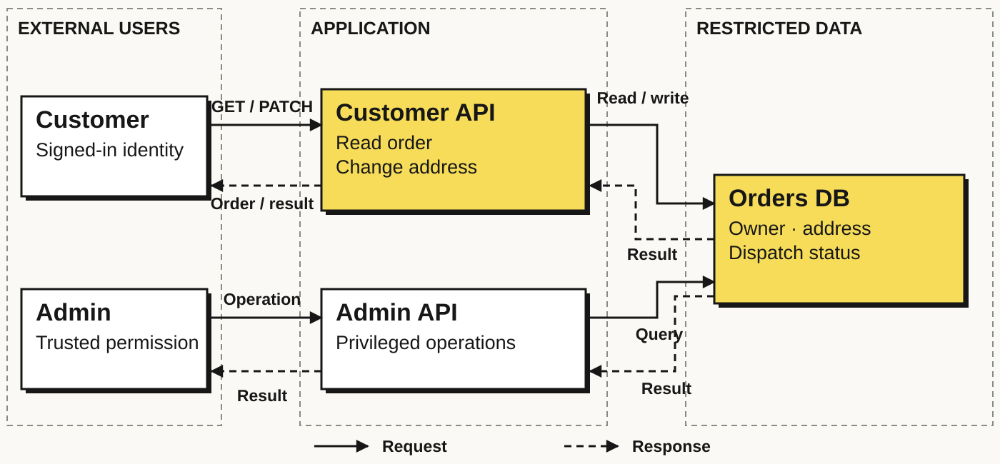

# The shop architecture

This fictional design has customers, a customer API, an orders database, and an admin interface/API. The customer API supports **reading orders and editing their delivery address before dispatch**. Location means the shipping destination, not courier GPS or tracking status. No real customer data is used.

| ID | Direction | Data |
|---|---|---|
| F1 | Customer → Customer API | Authenticated GET order / PATCH delivery-address request |
| F2 | Customer API → Customer | Order data, update result, or rejection |
| F3 | Customer API → Orders DB | Scoped read / authorized address update |
| F4 | Orders DB → Customer API | Order record / write result |
| F5 | Administrator → Admin panel/API | Authenticated privileged request |
| F6 | Admin panel/API → Administrator | Administrative response |
| F7 | Admin API → Orders DB | Authorized administrative query or change |
| F8 | Orders DB → Admin API | Query or change result |

Each request and response is drawn separately in both the presentation and editable model. Green solid arrows are requests; slate dashed arrows are responses in the presentation SVG. The admin box includes its interface and backend; hiding a browser button never establishes backend permission.

## Boundaries and controls

External clients control IDs and request bodies. The server derives identity from authenticated session context and authorizes the target order or privileged operation. Administrative permission is a logical boundary even if both APIs share a deployment. The application/data boundary requires least-privilege service access; being inside the network does not authorize every row.

Order confidentiality and integrity are assets. An ordinary authenticated customer can attempt another customer's order ID. The opening stipulates missing ownership checks and weak admin permission checks; other possible threats need investigation. Administrative network reachability is not established by this simplified diagram.

For GET and PATCH, enforce ownership independently of the submitted ID. For PATCH, accept only a valid delivery-address field and only while the order is processing. Denial must leave the stored record unchanged. In production, enforce the status condition and update atomically to avoid a race with dispatch, and apply consistent authorization across all endpoints. Choose a consistent forbidden/not-found response policy.

The sequence illustration uses 403 to communicate an explicit denial; the small Python sketch uses LookupError for inaccessible objects, which an HTTP implementation could map to 404. Both must prevent disclosure and mutation. The unit sketch contains no HTTP server or real database.

The database is not an independent proof of end-user permission: application credentials may have broad access, so the service must scope its use of those privileges. Trust-level annotations in Precogly are illustrative, not risk scores.

The growing-shop slide is a hypothetical extension for design discussion; the saved Precogly model and executable policy sketch cover the smaller architecture above.

## STRIDE review prompts

| Category | Question |
|---|---|
| Spoofing | Could a stolen session impersonate a customer? |
| Tampering | Could Alice redirect Bob's delivery? |
| Repudiation | Are privileged changes attributable in audit records? |
| Information disclosure | Could Alice read Bob's order? |
| Denial of service | Could repeated requests exhaust the API? |
| Elevation of privilege | Could a customer invoke an admin operation? |

These prompts are not six confirmed vulnerabilities. T1 groups the read and write consequences of one ownership failure; T2 covers unauthorized administrative operations.
