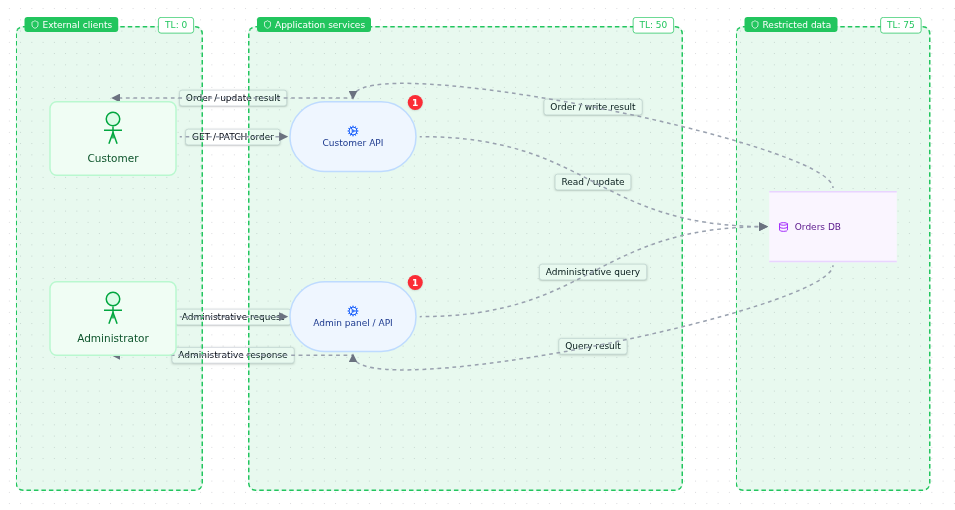

# Model the shop in Precogly

Start the local server with `bash start.sh` and open http://127.0.0.1:4174/guest. Choose **Open** and select `threat-model/shop-app.cdx.json` from this repository. Work on a copy and save your changes before closing the guest tab.

## 1. What are we working on?

Identify the customer, customer API, administrator, admin API and orders database. The three zones show changes in trust and privilege. Trace all eight directional flows: four requests and four responses.

Follow a customer's order ID and proposed address into the API. Then follow the database result and the response back. Distinguish data controlled by the caller from identity and permissions established by trusted server context. The database service credentials are not a replacement for customer authorization.

## 2. What can go wrong?

Choose **Analyze Threats**, select **Customer API**, then expand **T1 · Customer reads or redirects another order**.

Alice obtains Bob's identifier and submits a GET or PATCH request. A missing ownership check could reveal his order or redirect its delivery. These are two consequences of the same weakness: confidentiality and integrity matter on this route.

Ask what must be true for the path to work: the operation must be reachable, Alice must obtain a valid identifier, and authorization must be absent or bypassable. The example stipulates the weakness; a real review would validate it.

## 3. What are we going to do about it?

Expand **C1 · Authorize reads and address changes**. Hover the control and use its pencil button to read the full description.

The control requires ownership on reads and writes. Address editing also restricts the writable field and order state. Hard-to-guess identifiers and hidden UI elements do not enforce those rules.

Now select **Admin panel / API**, then T2 and C2. Compare the policies. An authorized operator may act on other people's orders, so customer ownership is not the right rule for every administrative operation. Check trusted permissions for the action. A caller-supplied `role=admin` is not proof of permission.

## 4. Did we do a good enough job?

Read the acceptance conditions in each control and compare them with `tests/test_authorization.py`:

- Legitimate customer reads and eligible address edits succeed.
- Cross-user reads and edits fail; denied edits leave the record unchanged.
- Edits after dispatch and unexpected fields fail.
- An ordinary customer cannot become an administrator by sending a role field.
- Removing the ownership guard makes both cross-user tests detect the missing control.

Run `python3 -m unittest discover -s tests -v`. The tests exercise policy sketches. They do not test network deployment, real authentication or database concurrency. For a production address update, preserve the eligibility condition atomically with the write.

## Keep the reasoning reviewable

Choose **Save**, use a new filename such as `shop-review.cdx.json`, and download it. Reopen that file and inspect T1/C1 and T2/C2 again. Check that the flows, descriptions and relationships survived.

This demonstrates retaining a structured model. It does not prove that the controls are implemented. Keep threats, controls and validation evidence separate when reviewing actual software.

A [recording of the guest workflow](../demo/precogly-walkthrough.mp4) is included if you want to see the interface before trying it.

Continue with the [design exercises](../exercises/README.md).
